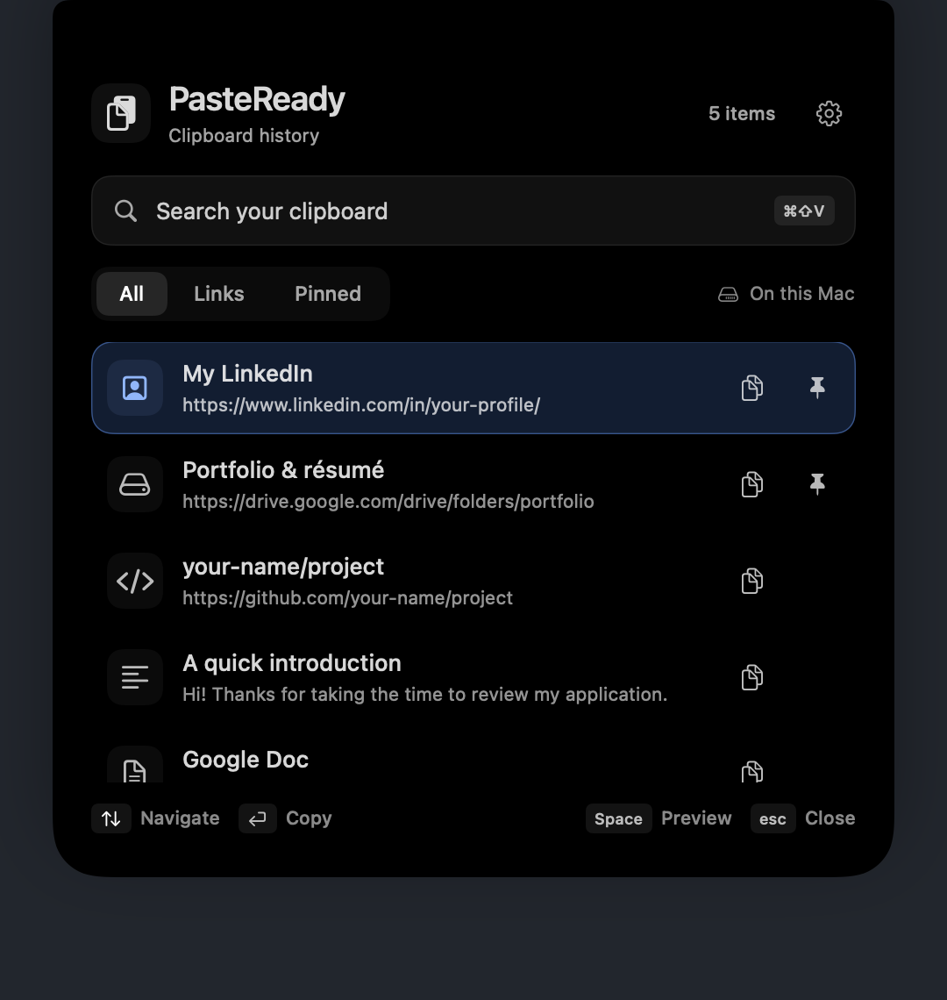

# PasteReady

**Copy once. Keep it within reach.**

A native Mac clipboard history that opens from your notch. Reuse links and text without hunting through tabs.



*Product preview with sample clipboard content.*

- **20 recent copies**, plus pinned favorites.
- **Hover to copy again**, or press **⌘⇧V** to choose and paste at your cursor.
- **Search, arrow keys, and Space preview** to find exactly what you need.
- **Stored on your Mac.** No network requests. Works with or without a notch.

## Install

Requires **macOS 14+** · Apple Silicon or Intel

```sh
curl -fsSL --proto '=https' --proto-redir '=https' https://github.com/sartha555k/PasteReady/releases/latest/download/install.sh | sh
```

Installs to `~/Applications`. Run again to update; your history and pins stay saved. Direct paste needs Accessibility access, enabled from PasteReady’s Settings.

Prefer a ZIP? [Download the latest release](https://github.com/sartha555k/PasteReady/releases/latest).

[Usage & privacy](docs/usage.md) · [Build & contribute](docs/development.md) · [Installer details](distribution/README.md)
